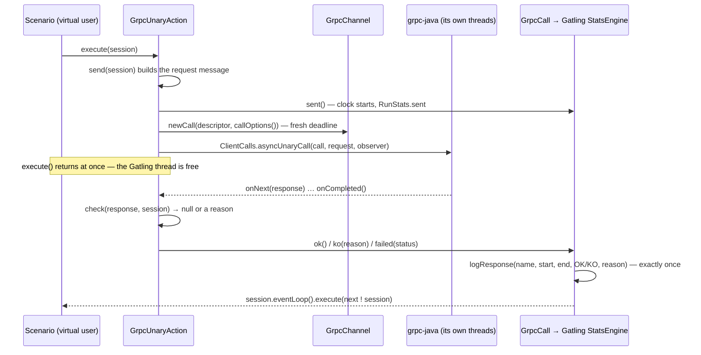

# gRPC load testing on current Gatling — with a connector you write yourself

Gatling's own gRPC support is **Gatling Enterprise-only**. The usual free answer is
[phisgr/gatling-grpc](https://github.com/phisgr/gatling-grpc), which works — and which pins you to **Gatling 3.9.5**, a release
from 2023. That is the trade my [previous demo](https://github.com/FruNoman/grpc-perf-demo) made.

This one doesn't trade: **Gatling 3.16.0, no Enterprise licence, no community gRPC library.** The gRPC support is ~1 300 lines of
Java in `core/grpc/` — a custom Gatling action over protoc's generated **method descriptors**, written once, and after that a gRPC
call reads the way Gatling Enterprise's own gRPC DSL does:

```java
exec(
        grpc("GRPCBin/DummyUnary")
            .unary(GRPCBinGrpc.getDummyUnaryMethod())
            .send(session -> DummyMessage.newBuilder()
                    .setFString(session.getString("payload"))
                    .build())
            .check(response(DummyMessage::getFString).isEL("#{payload}"))
);
```

Two things are deliberately not Gatling's: the channel is handed to the actions class instead of being a protocol in `setUp`, and
a stream is one action timed as a whole (`grpc(name).serverStream(…).send(…).check(messageCount().is(10))`) instead of a send and
an await. A lambda `.check((response, session) -> reasonOrNull)` stays for whatever `response(…)` and `messageCount()` cannot say.

No stub supplier, no method reference, no generated stub type in the feature package: `getDummyUnaryMethod()` already carries the
marshallers, the method's full name and its `MethodType`, and the request/response types are inferred from it. The generated
async stub's own method is nothing but
`ClientCalls.asyncUnaryCall(getChannel().newCall(getDummyUnaryMethod(), getCallOptions()), …)` — so the connector makes that call
itself and the stub disappears.

It shows up in the report, the assertions and the error table under its own name, next to HTTP requests if the project has any.
Every gRPC call shape is in the demo's session — gRPC has no GET or POST (every call is an HTTP/2 POST), it has four shapes:

| Call | Shape | What it stands for | Request in the report |
|---|---|---|---|
| `grpc("GRPCBin/Index").unary(…)` | unary, no input | a "GET" | `GRPCBin/Index` |
| `grpc("GRPCBin/DummyUnary").unary(…)` | unary with a body | a "POST" — the echo | `GRPCBin/DummyUnary` |
| `grpc("GRPCBin/DummyServerStream").serverStream(…)` | server streaming | batch download: 1 request → 10 chunks | `GRPCBin/DummyServerStream` |
| `grpc("GRPCBin/DummyBidirectionalStreamStream").bidiStream(…)` | bidi streaming | upload acknowledged per chunk: N → N | `GRPCBin/DummyBidirectionalStreamStream` |
| `grpc("GRPCBin/DummyClientStream").clientStream(…)` | client streaming | batch upload with one receipt: N → 1 | `GRPCBin/DummyClientStream` |

grpcbin's own `DummyClientStream` is broken server-side (below), so the simulation serves that one RPC in-process
(`MockClientStreamServer`, same proto, same generated descriptor) and calls it on its own channel — the call is the one a working
server would get; its latency is the generator's own JVM, not a service's.

The target is the same as the predecessor's: [grpcbin](https://github.com/moul/grpcbin) in Docker, an open-source echo gRPC
server built for exercising clients — the streaming counterpart of httpbin.

## The trick

```java
// build.gradle.kts — this is all of it
plugins {
    id("io.gatling.gradle") version "3.16.0"   // Gatling, community edition
    id("com.google.protobuf") version "0.9.4"  // stubs from src/gatling/proto, into the gatling source set
}

dependencies {
    gatlingImplementation("io.grpc:grpc-netty-shaded:1.68.0")
    gatlingImplementation("io.grpc:grpc-stub:1.68.0")
    gatlingImplementation("io.grpc:grpc-protobuf:1.68.0")
    gatlingCompileOnly("javax.annotation:javax.annotation-api:1.3.2")  // the @Generated on protoc's stubs
}
```

No gRPC library for Gatling at all. The connector is four things:

1. a `GrpcDsl` a feature's actions class extends, so `grpc(name).unary(descriptor)` has the run's channel without the call site
   passing anything, and `response(…)` / `messageCount()` are there to check with;
2. a `GrpcActionBuilder` implementing Gatling's Java-DSL `ActionBuilder`, so `exec(grpc(...))` composes like `exec(http(...))`;
3. an `Action` that makes the async `ClientCalls` call and writes the result into Gatling's `StatsEngine` — one `logResponse` with
   a start, an end, OK/KO and a reason;
4. a `GrpcChannel` with one `ManagedChannel` per target, opened in `before()`, closed in `after()`, and the per-call `CallOptions`.

The answer arrives on a gRPC thread, so the virtual user is handed on through `session.eventLoop()`, exactly as after an HTTP
response. A streaming RPC is its own action: messages counted in `onNext`, the request recorded at `onCompleted`, so the
measured time is the whole stream and not how long it took to open it.

Auth, which used to live on the stub, is one documented hatch — `.callOptions(options -> options.withCallCredentials(…))`, applied
per call. Static metadata is smaller as a channel interceptor.

## How it works

### One call, from `exec` to the report



1. **Build time.** `grpc("GRPCBin/DummyUnary").unary(GRPCBinGrpc.getDummyUnaryMethod())` is an ordinary Gatling Java-DSL
   `ActionBuilder`. When Gatling builds the scenario it calls `asScala()`, which checks two things before any user is injected: a
   `.send(…)` is there, and the descriptor's real `MethodType` is the shape the builder makes (`GrpcShape`).
2. **The request.** `execute(session)` runs the `.send(session -> …)` function on the user's session. If it throws (a missing
   feeder key) Gatling logs a *request crash* for that name and the user moves on — that is a bug in the test, not a KO of the
   service.
3. **The call.** The action does what protoc's generated async stub would do —
   `ClientCalls.asyncUnaryCall(channel.newCall(method, callOptions), request, observer)` — on the run's single channel. The
   `CallOptions` (and therefore the deadline) are built **per call**: a deadline is an absolute moment, shared options would
   expire for the whole run at once. `execute()` returns immediately; nothing waits on Gatling's few engine threads.
4. **The answer** arrives on a gRPC thread. `onError` turns the gRPC status into the KO reason (`DEADLINE_EXCEEDED: …`);
   `onCompleted` runs the checks — `response(DummyMessage::getFString).isEL("#{payload}")` compares the echo with the session's
   value and returns `response is 'x', expected 'y'` or nothing.
5. **The record.** `GrpcCall` is the only class that writes into Gatling: one `StatsEngine.logResponse` with the start, the end,
   OK/KO and the reason, so the request appears in the HTML report, the assertions and the error table under its name — next to
   HTTP requests if the simulation has any. It is guarded to record **once** (a stream can complete and then see a late deadline).
6. **Back to the user.** The session is handed to the next action through `session.eventLoop()`, exactly as Gatling does after
   an HTTP response, marked failed if the call was a KO.

### Streams

A stream is **one** action and **one** request in the report, timed from the first byte sent to the last message received:

| Builder | Under the hood | Measured |
|---|---|---|
| `.serverStream(d).send(…)` | `asyncServerStreamingCall`; messages counted in `onNext` | the whole download (grpcbin: ten messages, one per second → ~10 s) |
| `.bidiStream(d).send(n, (session, i) -> …)` | `asyncBidiStreamingCall`; message *i* is built and sent from an on-ready handler while `isReady()` | the whole upload, paced by gRPC's flow control instead of buffering every chunk in the generator's heap |
| `.clientStream(d).send(n, (session, i) -> …)` | the same builder, `asyncClientStreamingCall` | the whole batch upload until its one receipt |

`.check(messageCount().is(10))` catches a server that closes the stream early; a client stream's receipt is checked with
`last(…)`: `.check(messageCount().is(1), last(response(DummyMessage::getFInt32).is(uploadChunks)))`. `.bidiStream` and
`.clientStream` each accept only their own shape — the wrong descriptor fails the simulation before the first user.

### The run around the calls

- **The channel.** `GrpcChannel` holds one `ManagedChannel` per target: `start()` in the simulation's `before()`, `stop()` in
  `after()`. The actions are built in the constructor and read the channel at call time.
- **No protocol in `setUp`.** The actions class extends `GrpcDsl`, which carries the channel, so the call site never passes it.
- **Its own counting.** `RunStats` counts *sent* / *answered* / *messages* per request name, and `after()` prints it next to
  Gatling's numbers. Calls still open when the run's time limit hits are reported as sent and cut — not as failures.
- **The verdict.** Assertions per request name (`Limits`): a p95 limit each — a 5 ms echo and a 10 s download in one global
  percentile would hide each other — and zero failed calls. A red assertion fails the Gradle build, so CI needs no one to read
  the chart.
- **Auth.** `.callOptions(options -> options.withCallCredentials(…))` per call for a per-user token; static metadata as a channel
  interceptor.

### Why this is a custom action and not a library

Gatling's `Action` / `StatsEngine` is internal Scala API, not the documented Java DSL, so `core/grpc/` is written against a pinned
Gatling (3.16.0) and the smoke run is the upgrade test. In exchange there is no gRPC plugin to wait for: the same Gatling, the
same project and the same scenarios as the HTTP tests.

## Run it

```bash
docker compose up -d        # grpcbin on :9000 (plaintext)

# the headline: 50 concurrent users, every RPC shape per session
./gradlew gatlingRun -Dsimulation=GrpcbinSimulation -Dprofile=concurrency -Dusers=50 -DrampUp=15 -DsteadyState=60

# what runs after every change
./gradlew gatlingRun -Dsimulation=GrpcbinSimulation -Dprofile=smoke -Dusers=3

# why the call has to be the async one (see docs/run-notes.md)
./gradlew gatlingRun -Dsimulation=GrpcbinInjectorSimulation -Dprofile=load -Dcall=download -Drate=8 -DsteadyState=20
./gradlew gatlingRun -Dsimulation=GrpcbinInjectorSimulation -Dprofile=load -Dcall=download -Drate=8 -DsteadyState=20 -Dblocking=true
```

| Property | Default | Meaning |
|---|---|---|
| `-Dprofile` | `smoke` | `smoke` / `concurrency` (closed) · `load` / `stress` (open) |
| `-Dusers` | 50 | concurrent users, closed profiles |
| `-Drate` | 2 | sessions per second, open profiles |
| `-DrampUp` `-DsteadyState` | 15 / per profile | seconds |
| `-DpauseMs` | 200 | think time between the calls of a session |
| `-Dblocking` `-Dcall` | `false` / `download` | the injector simulation only |
| `-Denv` | `local` | a block of `src/gatling/resources/application.conf` (`public` points at grpcb.in over TLS) |
| `-Dlocal.grpcbin.chunk-bytes` | 65536 | any config value is overridable the same way |

The report is `build/reports/gatling/<run>/index.html`, and the run's exit code is the verdict: the simulation's assertions fail
the build, so this works in CI without anyone reading a chart.

## What the 50-user run actually did

Full numbers, including the applied-vs-planned check, in [docs/run-notes.md](docs/run-notes.md). The short version:

| Request | total | OK | KO | p95 | limit |
|---|---|---|---|---|---|
| `GRPCBin/DummyUnary` | 339 | 339 | 0 | 5 ms | 500 ms |
| `GRPCBin/DummyServerStream` | 293 | 293 | 0 | 10 034 ms | 11 000 ms |
| `GRPCBin/DummyBidirectionalStreamStream` | 291 | 291 | 0 | 28 ms | 1 000 ms |

923 requests, 0 KO, 12.31 req/s, 75 s wall clock, 50 concurrent users held for the whole plateau, all assertions green. The
connector's own counting (`968 sent / 923 answered / 45 cut by the run's end`, 6 179 messages) matches Gatling's report request
for request. The run before the descriptor DSL landed had 922 requests at 12.29 req/s with p95 6 / 10 057 / 29 ms — the refactor
moved the call site, not the measurement.

Those three p95 numbers differ by **two orders of magnitude**, which is the argument against a single global percentile: the
global p95 of this run is 10 027 ms, and it is the download, nothing else.

## Architecture

```
core/grpc/          GrpcDsl + GrpcRequest                      — grpc(name).unary / serverStream / bidiStream, inherited
                    GrpcResponseCheck, GrpcMessageCount        — response(…).isEL(…), messageCount().is(n)
                    GrpcActionBuilder + GrpcUnaryAction        — a unary call
                    GrpcServerStreamActionBuilder + Action     — a chunked download, timed whole
                    GrpcBidiStreamActionBuilder + Action       — a chunked upload under flow control
                    GrpcBlocking*ActionBuilder + Action        — the counter-example, kept to be measured
                    GrpcShape                                  — the RPC's shape checked at simulation start
                    GrpcCall                                   — the one place that writes into Gatling's StatsEngine
                    GrpcChannel                                — one channel per target, per run, and the per-call CallOptions
core/config/        Environment, Profile, LoadProfile          — HOCON per target, the run's shape from -D
core/simulation/    Injections, Sessions, Limits               — a profile's injection, its plan in words, its assertions
core/stats/         RunStats, RunSummaryLog                    — the run's own numbers, including messages per stream
grpcbin/actions/    GrpcbinActions                             — one method per RPC, the request built from the session
                    GrpcbinClientStreamActions                 — the client-stream batch upload, on the mock's channel
grpcbin/mock/       MockClientStreamServer                     — DummyClientStream served in-process (grpcbin's is broken)
grpcbin/scenarios/  GrpcbinScenarios                           — the session: index → echo → download → upload → batch upload
grpcbin/simulations/GrpcbinSimulation, GrpcbinInjectorSimulation
docs/               load-model.md (what a run answers, before the code), run-notes.md (what the runs did)
```

Feature code never touches the connector: an actions class extends `GrpcDsl` and names its RPCs, nothing else.
`src/gatling/proto/grpcbin.proto` is vendored
verbatim from a **pinned commit** of [moul/pb](https://github.com/moul/pb) by `./scripts/update-protos.sh`, so it is always
possible to say which version of grpcbin's API is under test; the Gradle protobuf plugin generates the stubs at build time.

## What was hard

**A deadline is absolute from the moment it is set.** The stub used to carry it (`newStub(channel).withDeadlineAfter(…)`, a fresh
stub per call), and once the stub is gone it moves into `CallOptions` — where `withDeadlineAfter` resolves to a *point in time*
there and then, not to a per-call timeout. Build the `CallOptions` once beside the channel and share them and the run dies at a
wall-clock moment with the service innocent: measured on the smoke profile with the options hoisted into a field, **87 requests,
12 OK, 75 KO**, every one of them `DEADLINE_EXCEEDED: ClientCall started after CallOptions deadline was exceeded`. So
`GrpcChannel.callOptions()` is a method, called inside the action, and the comment above it says why.

**The compiler used to check the RPC's shape; now the connector has to.** `grpc(name, Stub::dummyServerStream)` would not
typecheck — a `MethodDescriptor` typechecks for any shape, because the shape is data on it rather than a type. So each builder
asserts `method.getType()` in `asScala()`, which Gatling calls while the scenario is being built: a server-streaming RPC handed to
the unary builder fails before the first user is injected, with `GRPCBin/WrongShape: grpcbin.GRPCBin/DummyServerStream is
SERVER_STREAMING, this builder sends [UNARY]` — `grpc(name).unary(…)` names the shape, but only the descriptor knows the real one.
A runtime check at startup instead of a compile error is a real step down; it is the price of the call site.

**`ClientCalls.asyncBidiStreamingCall` starts the call before it gives you the request observer.** For a bidi upload you want
gRPC's flow control — send while the stream `isReady()`, let the server's reading pace you — and `setOnReadyHandler` throws once
the call has started. The only place left is `ClientResponseObserver.beforeStart`, which gRPC calls with the request stream before
anything goes out. Miss that and the honest-looking `for` loop over your chunks buffers every virtual user's whole upload in the
load generator's heap the moment the server reads slower than you send.

**Record each call exactly once.** A stream can report `onCompleted` and then a late `onError` — a deadline firing after the last
message. Log both and the report counts a request that never happened; so one `GrpcCall` per call, finished once, guarded.

**It is Gatling's internal Scala API, not the documented Java DSL.** `StatsEngine.logResponse`, `Action.!` (`$bang`), Scala's
`Option`, and a Java class that implements `StrictLogging` has to declare a setter with a name like
`com$typesafe$scalalogging$StrictLogging$_setter_$logger_$eq`. The signatures have held from Gatling 3.13 to 3.16, but that is
luck, not a contract: the version is pinned, and the smoke run is what proves the connector after an upgrade.

**The blocking call is wrong, and the reason is not the one you can state in one line.** `docs/run-notes.md` has the
measurements: on the 10 s download at 80 concurrent calls, the blocking variant applied **99 of 180 planned** calls, took 20 s
longer than its own injection, and reported the *same* p95 with *green* assertions — a green report of a load that never
happened. On the ~1 ms unary echo, the same blocking variant applied 62 500 of 62 500 at 5 000 calls/s. The ceiling is
`rate × latency` against the engine's threads, it moves with the machine, and nothing in the report tells you where it is. Which
is why the connector's real builders only make the async `ClientCalls` call and keep the blocking one in a simulation whose
job is to be slower.

**grpcbin's "chunked download" is a ten-second drip.** `DummyServerStream` sends its ten messages one per second. The first run
had a 10 s deadline and every download came back `DEADLINE_EXCEEDED` — verified with grpcurl that this is the server's pacing,
not the network's (10.3 s per stream against 0.2 s for a unary call). It makes grpcbin a better streaming target than expected:
with a drip like that, the difference between timing the whole stream and timing its opening is 10 051 ms against ~5 ms.

**`DummyClientStream` is still broken server-side** — `INTERNAL: grpc: error while marshaling: proto: Marshal called with nil`,
re-verified with grpcurl rather than taken from the predecessor's notes. So the demo serves that one RPC itself, in-process, from
the same proto — the client-stream call is real, only the server is a stand-in.

## License

[MIT](LICENSE) — fork it, adapt it, use it as your own template.
